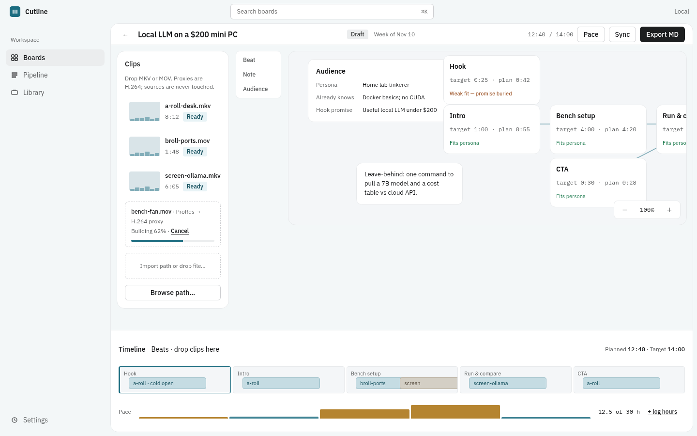
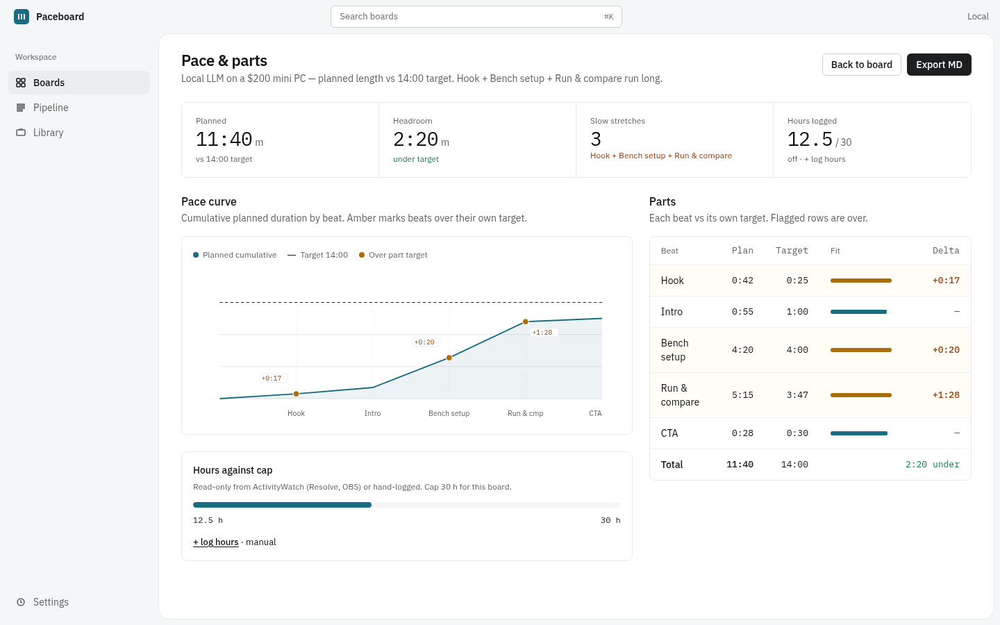
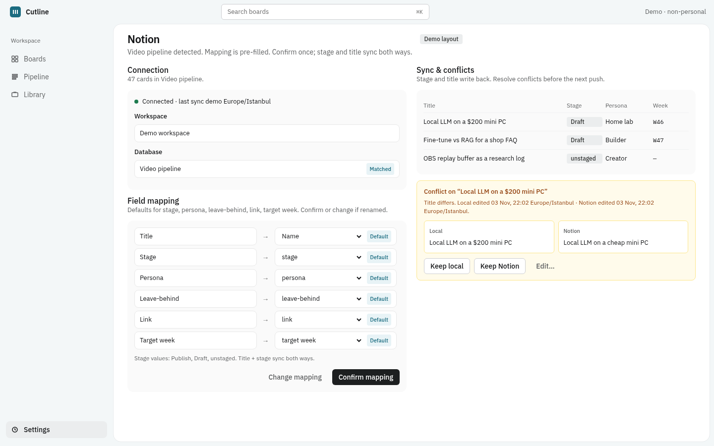
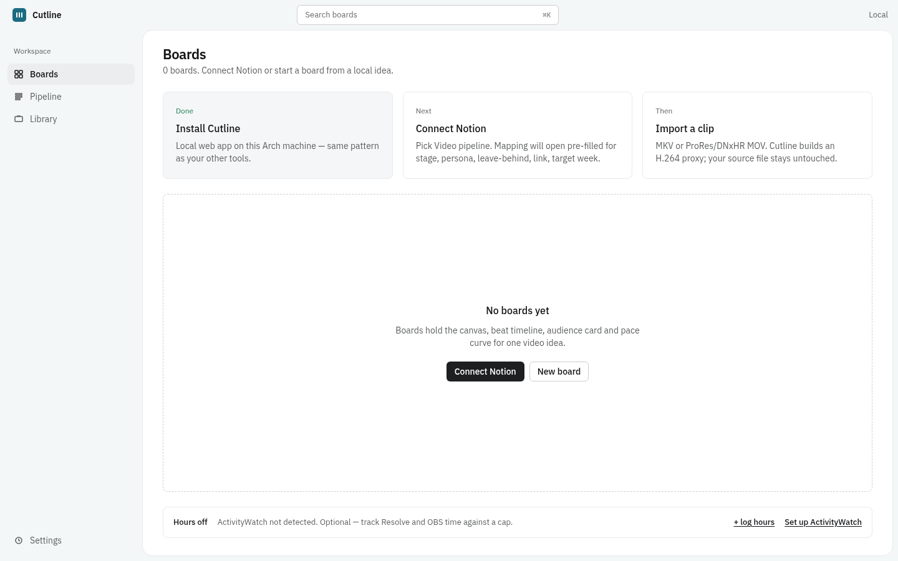

# Paceboard

Paceboard — a local canvas for planning YouTube videos before you edit.

Infinite canvas for beats, notes, clips, references, and audience cards; Notion idea-pipeline sync; local MKV / ProRes / DNxHR proxying for browser playback; timeline pacing; work-hours budget (optional ActivityWatch); Markdown / JSON export.

Framed-sheet UI (IBM Plex, teal accent). Tokens in `public/css/tokens.css` (dark-mode ready; light-only in v1). Product name lives in `public/js/brand.js`.

## Screenshots

Non-personal demo board (local seed data only — not shipped as product defaults).



*Canvas — board canvas with clips, audience card, beat graph, timeline and hours meter.*



*Pace & parts — cumulative pace curve, hours against cap, and per-beat plan vs target.*



*Notion — pre-filled field mapping and side-by-side conflict (Keep local / Keep Notion / Edit).*



*First-run — empty boards with setup steps and muted hours meter.*

## Requirements (Arch)

- Node.js **22.13+** (or 23.4+ / 24+; uses built-in `node:sqlite`, no native addons)
- npm
- ffmpeg (provides `ffmpeg` and `ffprobe`)
- git (for clone / one-line install)

```bash
sudo pacman -S --needed nodejs npm ffmpeg git
```

Paceboard stores boards in SQLite via Node's built-in [`node:sqlite`](https://nodejs.org/api/sqlite.html) (`DatabaseSync`). There is **no** `better-sqlite3` / node-gyp build step. On Node 22.13–25.6 you may see a one-time `ExperimentalWarning` for the sqlite module; it is harmless and suppressed by the app. Node 25.7+ / 26 treat it as a release candidate (no warning).

## Install

One-liner (clones into `~/paceboard` if needed, then installs):

```bash
curl -fsSL https://raw.githubusercontent.com/AlfaPigeon/paceboard/main/install.sh | bash
```

Or clone and install yourself:

```bash
git clone https://github.com/AlfaPigeon/paceboard.git && cd paceboard && ./install.sh
```

`install.sh` is idempotent: it updates the clone (`git pull --ff-only` when installed via the one-liner), runs `npm ci --omit=dev`, (re)writes the `systemd --user` unit (`paceboard.service`) and restarts it, refreshes `~/.local/bin/paceboard`, and the `.desktop` launcher that opens `http://127.0.0.1:3200/`.

- Default port **3200** (override with `PACEBOARD_PORT`)
- Runtime data / secrets: `~/.local/share/paceboard` (override with `PACEBOARD_DATA`); a local `./data/` folder is also used when you run from source without the env var
- Settings (including Notion token) stay on disk only and are gitignored

```bash
# manual run from a checkout
npm start

# tests
npm test

# uninstall service/launcher only (keeps files + data)
./uninstall.sh
```

## Connect Notion

1. In Notion, open **Settings → Connections → Develop or manage integrations** and create an **internal integration**. Copy the secret (token).
2. Open the database you use as your idea pipeline → **••• → Connections** → invite / share that integration so it can read and write the database. Copy the database id from the browser URL (`…/workspace/<database_id>?v=…`).
3. In Paceboard go to **Settings → Notion**, paste the token and database id, click **Save connection**, then **Fetch schema**.
4. Review the suggested property mapping and click **Confirm mapping** (confirm-only — nothing is overwritten until you import / push).
5. Import rows as boards from **Pipeline**, or open a board and **Sync** to push mapped fields back. Conflicts use `last_edited_time` and offer Keep local / Keep Notion / Edit.

Suggested default mapping (names only — no personal database ids ship in the repo):

| App field | Common Notion property |
|-----------|------------------------|
| title | Video / Title / Name |
| stage | Stage / Status |
| persona | Persona |
| leave_behind | Leave-behind |
| link | Link |
| target_week | Target week |

## Optional: ActivityWatch hours

Paceboard can sum window-watcher time for Resolve / OBS (read-only) into the board hours budget.

1. Install and run [ActivityWatch](https://activitywatch.net/) locally (default `http://localhost:5600`).
2. In **Settings → Hours**, enable ActivityWatch, adjust the base URL / app name filters if needed.
3. Per-board, set the hours cap (default **30h**) and optional title keyword / start date filters.

If ActivityWatch is down, the UI keeps working with manual hour logs only.

## Features

### Boards / canvas
One board per video idea. Cards (`beat`, `note`, `clip`, `reference`, `audience`), groups/sections, wires, drag + pan/zoom, autosave via `PUT /api/boards/:id/canvas`.

### Notion sync
Confirm-only mapping, import rows as boards, push title/stage/mapped fields with `last_edited_time` conflict detection (`409` unless `force`).

### Local video
Browse disk paths or upload. Sources are never modified. Background jobs probe with ffprobe, build an H.264 720p AAC proxy, thumbnail strip, waveform peaks, and scene cuts → clip cards with in/out points. Cache key = file hash + mtime.

DaVinci Resolve Free on Linux often uses MKV / ProRes / DNxHR `.mov`; proxies make them playable in the browser.

### Timeline + pacing
Ordered beats with planned durations and optional clip in/out. Flags use simple rules: beat vs average length, long talking segments without visual change, hook window, planned vs target runtime.

### Audience fit
Per-board audience card (who / already know / promise / persona). Beats can be marked as not serving the promise; the side panel lists orphans.

### Work hours
Per-board cap (default 30h). Manual hour entries always work. Optional ActivityWatch (off by default, read-only).

### Export
- Markdown script outline + shot list: `GET /api/export/:id/markdown`
- JSON board bundle import/export: `GET /api/export/:id/json`, `POST /api/export/import`

## API sketch

| Method | Path | Purpose |
|--------|------|---------|
| GET/POST | `/api/boards` | List / create |
| GET/PATCH/DELETE | `/api/boards/:id` | Read / update / delete |
| PUT | `/api/boards/:id/canvas` | Autosave cards, wires, groups, beats |
| GET | `/api/boards/:id/pacing` | Pace curve + flags |
| GET/PUT | `/api/settings` | Local settings (token stored on disk only) |
| GET | `/api/notion/databases` | List DBs the integration can see |
| GET | `/api/notion/schema` | Schema + suggested mapping |
| POST | `/api/notion/import` | Pull ideas → boards |
| POST | `/api/notion/boards/:id/push` | Write back (conflict aware) |
| GET | `/api/files/browse` | Server-side path browser |
| POST | `/api/media/import-path` | Queue proxy/thumbs/scenes job |
| POST | `/api/media/upload` | Upload + queue |
| GET | `/api/media/:id/proxy` | Stream proxy MP4 |
| POST | `/api/media/:id/clip-cards` | Spawn scene cards |
| GET/POST | `/api/hours/:boardId` | Hours summary / manual entries |
| GET | `/api/export/:id/markdown` | Markdown export |
| GET/POST | `/api/jobs/:id` (+ `/cancel`) | Background job status |

## License

MIT © AlfaPigeon
